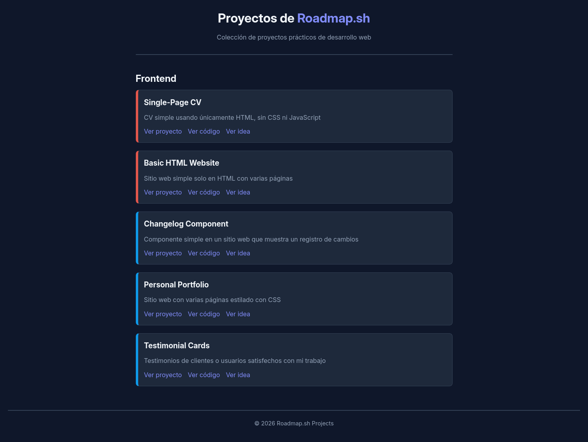

# Roadmap.sh Projects

Todos los proyectos de práctica de las rutas de [roadmap.sh][1].

El objetivo es practicar y ampliar mis conocimientos en desarrollo web. Mi meta es reunir en un solo repositorio todas las soluciones de los proyectos de roadmap.sh que vaya completando, para que estén disponibles para todos.

---

## 🔗 Ver proyecto

Accede al siguiente enlace para ver el proyecto desplegado:

🚀 [Ver Índice de proyectos][4]

---

## 👨🏽‍💻 Mis Proyectos

Todos los proyectos realizados:

### 💻 Frontend

#### 🧱 Nivel 1: HTML

1. [x] [Single-Page CV](https://chriscraftx.github.io/Roadmap.sh-Projects/frontend/single-page-cv/)
2. [x] [Basic HTML Website](https://chriscraftx.github.io/Roadmap.sh-Projects/frontend/basic-html-website/)

#### 🎨 Nivel 2: CSS

1. [x] [Changelog Component](https://chriscraftx.github.io/Roadmap.sh-Projects/frontend/changelog-component/)
2. [x] [Personal Portfolio](https://chriscraftx.github.io/Roadmap.sh-Projects/frontend/personal-portfolio/) <!-- actualizar a: portfolio-website -->
3. [x] [Testimonial Cards](https://chriscraftx.github.io/Roadmap.sh-Projects/frontend/testimonial-cards/)

#### ⚡ Nivel 3: JavaScript

- No hay proyectos de **JavaScript** realizados.

### 🧠 Backend

- No hay proyectos de **Backend** realizados.

---

## ⭐ Apoyar mi trabajo

Si consideras que estoy haciendo un buen trabajo, puedes votar el proyecto en [roadmap.sh][1] con 👍:

⭐ [Apoyar un proyecto: `Single-Page CV`][3] <!-- Es el proyecto que más apoyo necesita hasta el momento. -->

---

## 🖇️ Referencias

Algunos enlaces de interés:

- 💡 [Ver ideas de proyectos][2]
- 🌱 [Empezar a contribuir](DEVELOPMENT.md)
- 🧠 [Ver bitácora de desarrollo](DEVLOG.md)
- 📑 [Ver tareas pendientes](TASKS.md)

---

[1]: https://roadmap.sh
[2]: https://roadmap.sh/projects
[3]: https://roadmap.sh/projects/single-page-cv/solutions?u=68bd2cf6d26114391c4bf90c
[4]: https://chriscraftx.github.io/Roadmap.sh-Projects/
